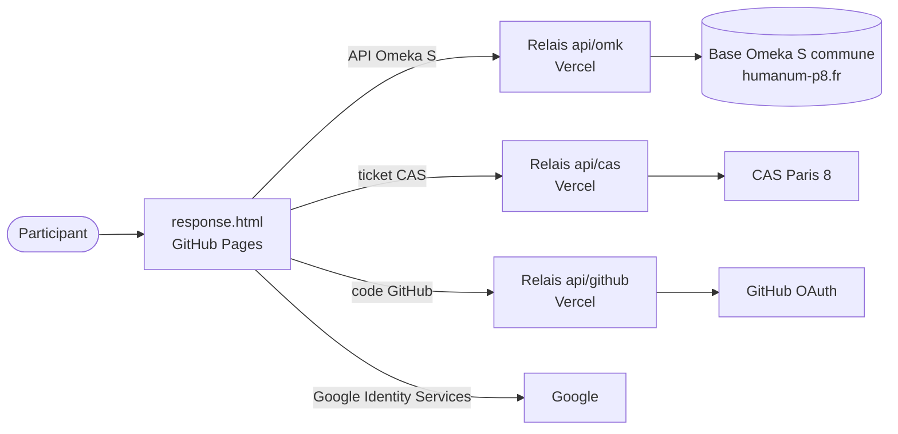

# ArtificialInquiries_1 — « Draw It Like You See It »

Transformation en outil numérique de l'**exercice 1** du vademecum *Artificial Inquiries: A Vademecum for Workers in the Age of AI* (Alcaras, Ricci, Prinetti, de Vries, médialab Sciences Po, 2025 — [https://hal.science/hal-05327878](https://hal.science/hal-05327878)).

**Page en ligne : [https://antoinejarnoux.github.io/ArtificialInquiries_1/response.html](https://antoinejarnoux.github.io/ArtificialInquiries_1/response.html)**

---

## 1. L'exercice

**Bloc 01 — Qualifying, exercice 1 (p. 6-7).** C'est le premier exercice du livre : avant de documenter son usage des LLM, on fixe sa représentation de départ.

Sur papier, la page contient :

- **deux carrés à dessiner**, de tête, sans faire de recherche :
  1. à quoi ressemble un LLM (comment on imagine son fonctionnement) ;
  2. à quoi ressemble son environnement de travail ;
- **une question écrite** : « En quelques mots, que fais-tu ? ».

L'intérêt est de **comparer les deux dessins** : est-ce que le LLM apparaît dans le dessin du travail ? Qu'est-ce qui revient dans les deux ?

## 2. Pourquoi un outil numérique

Sur papier, on n'a qu'une page et on ne la refait pas. En numérique :

- on peut **refaire l'exercice à plusieurs moments** (avant les autres exercices, après un bloc, à la fin de l'enquête) et voir comment sa vision évolue ;
- les réponses sont **enregistrées dans la base Omeka S commune du cours**, avec le vocabulaire commun `artinq`, à côté de celles des autres exercices ;
- on peut **regarder les réponses des autres** et comparer.

## 3. Utiliser la page

### Se connecter

| Méthode | Ce qu'il faut | Ce qu'on peut faire |
|---|---|---|
| **Clé API Omeka S** | email + `key_identity` + `key_credential`, créés sur la base commune (ton nom → Edit → API keys) | faire l'exercice, modifier, supprimer |
| **GitHub** | bouton « Se connecter avec GitHub » (ou un jeton personnel si l'application OAuth n'est pas réglée) | lecture seule, ou écriture si la clé API est aussi remplie |
| **Google** | bouton Google | idem |
| **Université Paris 8 (CAS)** | identifiant de la fac | idem |
| **Sans compte** | rien | lecture seule : voir les réponses |

L'écriture dans la base demande toujours une clé API Omeka : GitHub, Google et le CAS servent à dire **qui** on est (un participant par compte : `fournisseur` + `identifiant`). Si la base refuse la clé, la page l'explique et passe en lecture seule.

### Fonctionnalités

| Fonction | Détail |
|---|---|
| Dessin | 2 carrés, 5 couleurs, gomme ; souris, doigt ou stylet |
| Annuler / effacer | par carré : dernier trait, ou tout |
| Question écrite | « En quelques mots, que fais-tu ? » |
| Moment | avant les autres exercices, après le bloc 02, 03 ou 04, à la fin de l'enquête |
| Mes réponses | liste de ses passations, avec les 2 dessins et la phrase |
| Réponses des autres | case « Voir aussi les réponses des autres » (toujours affiché en lecture seule) |
| CRUD | **C**réer (Faire l'exercice), **R**elire (liste), **M**odifier (redessiner, changer la phrase), **S**upprimer (avec confirmation) |

## 4. Solutions techniques

### Architecture



- **Page** : HTML / CSS / JavaScript sans framework, en un seul fichier, publiée sur GitHub Pages.
- **Pourquoi des relais** : la base commune n'envoie pas d'en-tête CORS, donc un navigateur ne peut pas l'appeler depuis `github.io`. Les fonctions Vercel du dossier `api/` font l'appel côté serveur et ajoutent l'en-tête CORS. Elles n'acceptent que la page de ce dépôt (et `localhost` pour les tests), et ne relaient que la base commune.
  - `api/omk.mjs` : relaie l'API Omeka S (GET, POST, PUT, DELETE, envoi d'images).
  - `api/cas.mjs` : vérifie le ticket du CAS de Paris 8 (`serviceValidate`), que le navigateur ne peut pas vérifier seul.
  - `api/github.mjs` : échange le code GitHub contre un jeton avec le secret de l'application OAuth (variable Vercel `GITHUB_CLIENT_SECRET`), puis renvoie seulement le nom public. Le jeton et le secret ne vont jamais dans la page.
- **Dessin** : Canvas 2D + Pointer Events (souris, doigt, stylet). Chaque trait est gardé comme `{outil, couleur, epaisseur, points[]}`, ce qui permet d'annuler et de redessiner.

### Les données dans Omeka S

- Le modèle est décrit dans **[diagram_class.md](diagram_class.md)**.
- Vocabulaire commun `artinq` ([artificial_inquiries.ttl](artificial_inquiries.ttl) en reprend les termes utilisés) et 7 modèles de ressource **« Ex1 … »** ([resource-template/](resource-template/)).
- Une passation = 1 item `Passation`, relié à son `Participant`, à l'item « Exercice 1 » et à ses 3 réponses. Un dessin = 1 item `ReponseDessin` avec son image PNG (média) et un item `Trait` par trait (les points sont dans `artinq:points`, en JSON).
- À la première connexion avec une clé, la page crée elle-même les modèles « Ex1 … » et les 3 questions s'ils manquent.

## 5. Structure du dépôt

```
ArtificialInquiries_1/
├── response.html              la page (interface + CRUD)
├── api/
│   ├── omk.mjs                relais de l'API Omeka S (Vercel)
│   ├── cas.mjs                relais de validation CAS (Vercel)
│   └── github.mjs             connexion GitHub OAuth (Vercel)
├── resource-template/         les 7 modèles « Ex1 … » (export Omeka S)
├── artificial_inquiries.ttl   termes du vocabulaire artinq utilisés
├── diagram_class.md           diagramme de classes Mermaid
├── cas/validate.php           ancien relais CAS pour un Omeka local (XAMPP)
├── omk.sql                    export de la base locale de développement
└── README.md
```

## 6. Mise en place (pour refaire le déploiement)

1. **GitHub Pages** sur la branche `main` (racine) : la page est servie sur `https://<compte>.github.io/ArtificialInquiries_1/response.html`.
2. **Vercel** : importer le dépôt (préréglage « Other »). Les fichiers de `api/` deviennent les relais `https://<projet>.vercel.app/api/...`.
3. **GitHub OAuth** : créer une application OAuth (GitHub → Settings → Developer settings → OAuth Apps) avec comme *callback URL* l'adresse de `response.html`, mettre son Client ID dans `response.html` (`DEFAULTS.github`) et `api/github.mjs`, et son secret dans la variable Vercel `GITHUB_CLIENT_SECRET`.
4. **Google** : un Client ID OAuth « Application Web » avec l'origine `https://<compte>.github.io`, dans `DEFAULTS.google`.

## 7. Tests

La page a été testée de bout en bout sur un Omeka S 4.2.1 de test, avec les relais et un faux CAS : connexion avec et sans clé, clé refusée, mode sans compte, GitHub, Google, CAS, puis Create, Read, Update et Delete (avec les images et les traits).

## 8. Références

- Alcaras G., Ricci D., Prinetti T., de Vries Z. (2025). *Artificial Inquiries*. Éditions Annexes / médialab Sciences Po. [https://hal.science/hal-05327878](https://hal.science/hal-05327878)
- API Omeka S : [https://omeka.org/s/docs/developer/api/](https://omeka.org/s/docs/developer/api/)
- Mermaid, diagramme de classes : [https://mermaid.js.org/syntax/classDiagram.html](https://mermaid.js.org/syntax/classDiagram.html)
