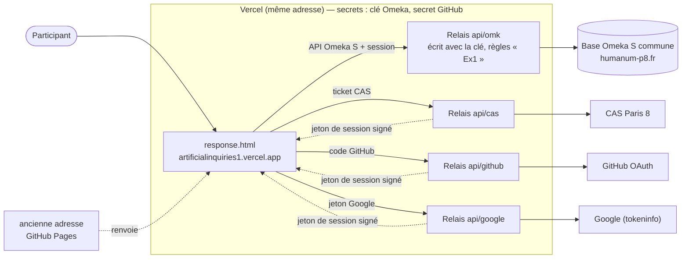

# ArtificialInquiries_1 — « Draw It Like You See It »

Transformation en outil numérique de l'**exercice 1** du vademecum *Artificial Inquiries: A Vademecum for Workers in the Age of AI* (Alcaras, Ricci, Prinetti, de Vries, médialab Sciences Po, 2025 — [https://hal.science/hal-05327878](https://hal.science/hal-05327878)).

**Page en ligne : [https://artificialinquiries1.vercel.app/](https://artificialinquiries1.vercel.app/)** (l'ancienne adresse [https://antoinejarnoux.github.io/ArtificialInquiries_1/response.html](https://antoinejarnoux.github.io/ArtificialInquiries_1/response.html) y renvoie).

---

## 1. L'exercice

**Bloc 01 — Qualifying, exercice 1 (p. 6-7).** C'est le premier exercice du livre : avant de documenter son usage des LLM, on fixe sa représentation de départ.

Sur papier, la page contient :

- **deux carrés à dessiner**, de tête, sans faire de recherche :
  1. à quoi ressemble un LLM (comment on imagine son fonctionnement) ;
  2. à quoi ressemble son environnement de travail ;
- **une question écrite** : « En quelques mots, que fais-tu ? ».

L'intérêt est de **comparer les deux dessins** : est-ce que le LLM apparaît dans le dessin du travail ? Qu'est-ce qui revient dans les deux ?

## 2. Pourquoi un outil numérique

Sur papier, on n'a qu'une page et on ne la refait pas. En numérique :

- on peut **refaire l'exercice à plusieurs moments** (avant les autres exercices, après un bloc, à la fin de l'enquête) et voir comment sa vision évolue ;
- les réponses sont **enregistrées dans la base Omeka S commune du cours**, avec le vocabulaire commun `artinq`, à côté de celles des autres exercices ;
- on peut **regarder les réponses des autres** et comparer.

## 3. Utiliser la page

### Se connecter

On arrive sur l'écran de connexion. Trois boutons, rien à remplir :

| Méthode | Ce qui se passe |
|---|---|
| **GitHub** | page « Authorize » de GitHub, puis retour sur l'exercice |
| **Google** | choix du compte Google, puis retour sur l'exercice |
| **Université Paris 8 (CAS)** | page de connexion de la fac, puis retour sur l'exercice |
| **Sans compte** (lien « Voir les réponses sans compte ») | lecture seule : on voit les réponses de tout le monde |

Une fois connecté, on peut faire l'exercice, relire, modifier et supprimer **ses** réponses, et regarder celles des autres. Chaque compte devient un `Participant` dans la base (`fournisseur` + `identifiant`). Sans compte, rien n'est créé dans la base.

### Où sont les secrets

- **Aucun secret dans la page.** La clé API Omeka et le secret GitHub sont des variables d'environnement Vercel, lues seulement par les relais (`api/`).
- **Chaque connexion est vérifiée côté serveur** : le relais GitHub échange le code avec le secret, le relais Google fait vérifier le jeton par Google, le relais CAS vérifie le ticket auprès du CAS de Paris 8. Ensuite il remet à la page un **jeton de session signé** (12 h, gardé seulement dans l'onglet).
- **Le relais `api/omk` écrit avec la clé de Vercel seulement si la page montre une session valide**, et seulement :
  - des éléments des modèles « Ex1 … » ;
  - chaque élément reçoit `dcterms:creator` = `fournisseur:identifiant` de la personne connectée (par exemple `github:AntoineJarnoux`) ;
  - on ne modifie ou supprime que ses propres éléments (et leurs images) ;
  - un `Participant` ne peut être créé que pour soi-même.
- **Lecture** : sans clé, seulement les éléments publics.
- **« Se déconnecter »** oublie la session. Après une connexion CAS, la page ferme aussi la session du CAS de Paris 8 (`/cas/logout`).
- **Si le relais ne répond plus**, la page le dit ; si c'est la base commune qui ne répond pas, le relais le dit aussi.

### Fonctionnalités

| Fonction | Détail |
|---|---|
| Dessin | 2 carrés, 5 couleurs, gomme ; souris, doigt ou stylet |
| Annuler / effacer | par carré : dernier trait, ou tout |
| Question écrite | « En quelques mots, que fais-tu ? » |
| Moment | avant les autres exercices, après le bloc 02, 03 ou 04, à la fin de l'enquête |
| Mes réponses | liste de ses passations, avec les 2 dessins et la phrase |
| Réponses des autres | case « Voir aussi les réponses des autres » (sans bouton Modifier ni Supprimer) |
| CRUD | **C**réer (Faire l'exercice), **R**elire (liste), **M**odifier (redessiner, changer la phrase), **S**upprimer (avec confirmation) |

## 4. Solutions techniques

### Architecture



- **Page** : HTML / CSS / JavaScript sans framework, en un seul fichier. Vercel la sert à la racine du site (`vercel.json` : `/` → `response.html`), donc on arrive directement sur l'écran de connexion. `.vercelignore` fait que Vercel ne publie que la page, les relais et `lib/`. L'ancienne page GitHub Pages renvoie vers Vercel.
- **Pourquoi des relais** : la base commune n'envoie pas d'en-tête CORS, et les secrets ne doivent pas être dans la page. Les fonctions Vercel du dossier `api/`, à la même adresse que la page, font les appels côté serveur. Elles n'acceptent que la page de ce dépôt (et `localhost` pour les tests), et ne relaient que la base commune.
  - `api/omk.mjs` : lit la base (sans clé) ; écrit avec la clé de Vercel (`OMEKA_KEY_IDENTITY`, `OMEKA_KEY_CREDENTIAL`) pour une session valide, avec les règles ci-dessus.
  - `api/github.mjs` : échange le code GitHub contre un jeton avec le secret de l'application OAuth (`GITHUB_CLIENT_SECRET`), lit le nom public et renvoie la session. L'adresse de retour déclarée chez GitHub est restée l'ancienne page GitHub Pages, qui renvoie aussitôt vers Vercel avec le code.
  - `api/google.mjs` : fait vérifier le jeton Google (`tokeninfo`), contrôle qu'il a été émis pour notre Client ID, et renvoie la session.
  - `api/cas.mjs` : vérifie le ticket du CAS de Paris 8 (`serviceValidate`) et renvoie la session.
  - `lib/session.mjs` : fabrique et vérifie le jeton de session (HMAC-SHA256 avec `SESSION_SECRET`, ou à défaut `GITHUB_CLIENT_SECRET`).
- **Dessin** : Canvas 2D + Pointer Events (souris, doigt, stylet). Chaque trait est gardé comme `{outil, couleur, epaisseur, points[]}`, ce qui permet d'annuler et de redessiner.

### Les données dans Omeka S

- Le modèle est décrit dans **[diagram_class.md](diagram_class.md)**.
- Vocabulaire commun `artinq` ([artificial_inquiries.ttl](artificial_inquiries.ttl) en reprend les termes utilisés) et 7 modèles de ressource **« Ex1 … »** ([resource-template/](resource-template/)).
- Une passation = 1 item `Passation`, relié à son `Participant`, à l'item « Exercice 1 » et à ses 3 réponses. Un dessin = 1 item `ReponseDessin` avec son image PNG (média) et un item `Trait` par trait (les points sont dans `artinq:points`, en JSON).
- Chaque élément écrit par la page porte `dcterms:creator` = `fournisseur:identifiant` de son auteur : c'est ce que le relais vérifie avant une modification ou une suppression.
- Si un modèle « Ex1 … » manque, la page le crée (le relais n'accepte que les modèles « Ex1 … » absents).

## 5. Structure du dépôt

```
ArtificialInquiries_1/
├── response.html              la page (interface + CRUD)
├── vercel.json                la racine du site Vercel affiche response.html
├── .vercelignore              Vercel ne publie que la page et api/
├── api/
│   ├── omk.mjs                relais de l'API Omeka S : lecture, et écriture avec la clé de Vercel (règles « Ex1 »)
│   ├── github.mjs             connexion GitHub OAuth → session
│   ├── google.mjs             connexion Google (jeton vérifié par Google) → session
│   └── cas.mjs                connexion CAS Paris 8 (ticket vérifié) → session
├── lib/session.mjs            jeton de session signé, partagé par les relais
├── resource-template/         les 7 modèles « Ex1 … » (export Omeka S)
├── artificial_inquiries.ttl   termes du vocabulaire artinq utilisés
├── diagram_class.md           diagramme de classes Mermaid
├── cas/validate.php           ancien relais CAS pour un Omeka local (XAMPP)
├── omk.sql                    export de la base locale de développement
└── README.md
```

## 6. Mise en place (pour refaire le déploiement)

1. **Vercel** : importer le dépôt (préréglage « Other »). La page est servie à la racine `https://<projet>.vercel.app/` et les fichiers de `api/` deviennent les relais `https://<projet>.vercel.app/api/...`. Variables d'environnement (Settings → Environment Variables) : `OMEKA_KEY_IDENTITY` et `OMEKA_KEY_CREDENTIAL` (clé API du compte qui écrit dans la base commune), `GITHUB_CLIENT_SECRET`, et si on veut `SESSION_SECRET` (sinon le secret GitHub sert aussi à signer les sessions). Puis « Redeploy ».
2. **GitHub Pages** sur la branche `main` (racine) : garde l'ancienne adresse, qui renvoie vers Vercel (script en tête de `response.html`).
3. **GitHub OAuth** : créer une application OAuth (GitHub → Settings → Developer settings → OAuth Apps) avec comme *callback URL* l'adresse GitHub Pages de `response.html` (`GITHUB_CALLBACK` dans la page, `REDIRECT_URI` dans `api/github.mjs`), mettre son Client ID dans `response.html` (`DEFAULTS.github`) et `api/github.mjs`, et son secret dans la variable Vercel `GITHUB_CLIENT_SECRET`.
4. **Google** : un Client ID OAuth « Application Web » avec l'origine `https://<projet>.vercel.app` dans « Origines JavaScript autorisées », dans `DEFAULTS.google`.

## 7. Tests

La page a été testée de bout en bout sur un Omeka S 4.2.1 de test, avec les relais, un faux CAS et un faux GitHub / Google (29 vérifications, plus 5 pour l'adresse Vercel) :

- écran de connexion : GitHub, Google, l'université et le lien « sans compte », aucun champ à remplir ;
- sans compte : lecture seule de toutes les réponses, rien de créé dans la base ;
- connexion GitHub, Google et CAS (avec annulation, code refusé, jeton Google d'une autre application) ;
- Create, Read, Update et Delete (avec les images et les traits), tout étiqueté par le relais ;
- règles du relais : écriture refusée sans session ou avec une session inventée, hors modèles « Ex1 », pour un participant au nom de quelqu'un d'autre, sur l'item « Exercice », ou sur la réponse (ou l'image) de quelqu'un d'autre ; message clair si la clé n'est pas réglée sur Vercel ;
- adresse Vercel : écran de connexion à la racine, renvoi depuis github.io, retour GitHub, CAS.

**Avec le vrai CAS de Paris 8** (`cas.univ-paris8.fr`), le 24/11/2026 :

| Étape | Résultat |
|---|---|
| « Se connecter avec l'université » | la page de connexion du CAS s'ouvre et accepte l'adresse de `response.html` comme service |
| Vérification du ticket par le relais `api/cas` | le relais interroge bien le vrai CAS : un faux ticket est refusé (`INVALID_TICKET`, « le ticket … est inconnu ») |
| Déconnexion | `/cas/logout?service=…` ferme la session du CAS et renvoie sur `response.html` |

## 8. Références

- Alcaras G., Ricci D., Prinetti T., de Vries Z. (2025). *Artificial Inquiries*. Éditions Annexes / médialab Sciences Po. [https://hal.science/hal-05327878](https://hal.science/hal-05327878)
- API Omeka S : [https://omeka.org/s/docs/developer/api/](https://omeka.org/s/docs/developer/api/)
- Mermaid, diagramme de classes : [https://mermaid.js.org/syntax/classDiagram.html](https://mermaid.js.org/syntax/classDiagram.html)
