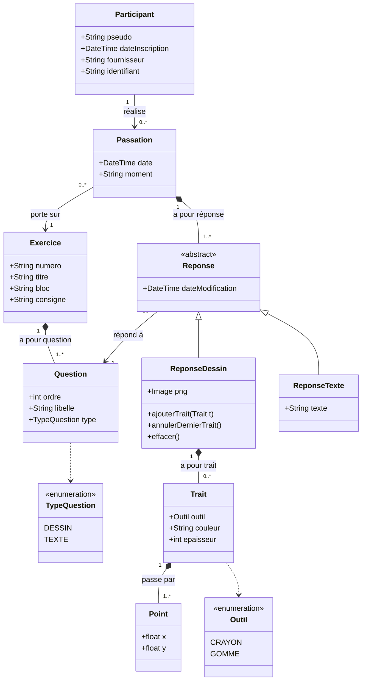

# Diagramme de classes — Exercice 1 « Draw It Like You See It »

Modèle des données nécessaires pour gérer l'exercice : qui fait l'exercice, quand, et ce qu'il a dessiné et écrit. Les attributs et les liens utilisent les noms du vocabulaire commun `artinq`.



## Lecture du diagramme

- Un **Participant** réalise plusieurs **Passations** de l'exercice. C'est ce qui permet de refaire l'exercice à différents moments et de comparer. Son `fournisseur` (omeka, github, google ou cas) et son `identifiant` indiquent avec quel compte il s'est connecté (ex. `github` + `AntoineJarnoux`).
- Un **Exercice** contient ses **Questions**. Pour l'exercice 1 il y en a trois (tableau ci-dessous). Le modèle reste valable pour d'autres exercices du vademecum.
- Une **Passation** contient une **Réponse** par question. Une réponse est soit un **dessin**, soit un **texte** (héritage).
- Un **dessin** est une suite de **Traits** ; un trait a un outil, une couleur, une épaisseur et une suite de **Points**. Garder les traits (et pas seulement l'image) permet d'annuler et de redessiner une réponse quand on la modifie.

### Instances pour l'exercice 1

| Question | ordre | type | libellé |
|---|---|---|---|
| Q1 | 1 | DESSIN | À quoi ressemble un LLM ? |
| Q2 | 2 | DESSIN | À quoi ressemble ton environnement de travail ? |
| Q3 | 3 | TEXTE | En quelques mots, que fais-tu ? |

## Enregistrement dans Omeka S

Chaque classe est un item de la base commune, avec la classe `artinq` du même nom et le modèle de ressource « Ex1 … » :

| Classe | Modèle | Propriétés |
|---|---|---|
| Participant | Ex1 Participant | `artinq:pseudo`, `artinq:dateInscription`, `artinq:fournisseur`, `artinq:identifiant` |
| Exercice | (item « Exercice 1 » de la base) | `artinq:aPourQuestion` |
| Question | Ex1 Question | `artinq:ordre`, `artinq:libelle`, `artinq:type` |
| Passation | Ex1 Passation | `dcterms:title`, `artinq:date`, `artinq:moment`, `artinq:realiseePar`, `artinq:porteSur`, `artinq:aPourReponse` |
| ReponseDessin | Ex1 ReponseDessin | `dcterms:title`, `artinq:repondA`, `artinq:aPourTrait`, `artinq:dateModification` + l'image PNG en média |
| ReponseTexte | Ex1 ReponseTexte | `dcterms:title`, `artinq:repondA`, `artinq:texte`, `artinq:dateModification` |
| Trait | Ex1 Trait | `artinq:outil`, `artinq:couleur`, `artinq:epaisseur`, `artinq:points` |

Les **Points** d'un trait ne sont pas des items : ils sont dans `artinq:points`, en JSON (liste de couples `[x, y]` sur un carré de 900 × 900) :

```json
{ "artinq:outil": "CRAYON", "artinq:couleur": "#232a38", "artinq:epaisseur": 7,
  "artinq:points": "[[120.5,340.0],[131.2,338.4],[145.0,335.9]]" }
```
